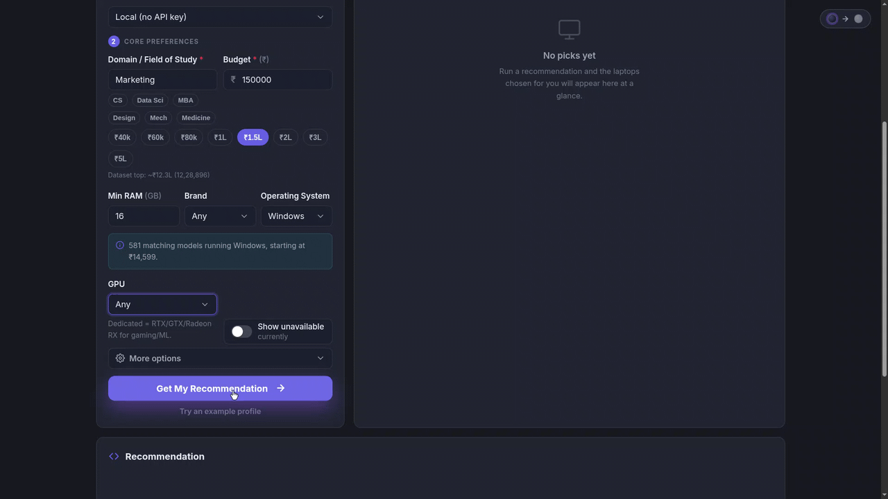
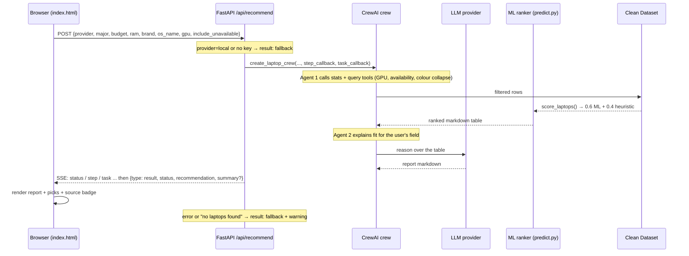

# 🖥️ AI Laptop Recommendation System (Amazon + CrewAI)

A full-stack app that recommends the **best laptop for a student or professional profile** (field of study, budget, RAM, brand, OS, GPU preference, availability) using **CrewAI multi-agent AI** over a **real scraped Amazon India catalog**, served by **FastAPI** with a single-file **dashboard** and an **ML ranker** that puts the best value picks on top.



> **No API key? No problem.** Choose the **Local** provider (or let the keys be missing) and the app falls back to a grounded, deterministic recommendation built from the local dataset. It also falls back automatically if the AI errors out or concludes "no laptops found" — so the app is always usable.

---

## ✨ What it does

1. You fill in a short profile: **Domain / Field, Budget, Min RAM, Brand, OS, GPU** (`Any / Dedicated / Integrated / a name like RTX 4060`), whether to **show currently unavailable** laptops, and optional specific needs.
2. You pick a provider: **Gemini, OpenAI, OpenRouter, NVIDIA**, or **Local** (no key needed). With an AI provider, a **CrewAI crew** of two specialist agents runs in the background:
   - **Laptop Database Specialist** — queries the real catalog with tools (stats + filtered queries), never inventing specs.
   - **Academic & Professional Hardware Advisor** — turns the raw matches into a personalized markdown report (why each spec fits your workload, pros/cons, comparison table).
3. The dashboard streams **live progress** over Server-Sent Events ("Searching the laptop catalog", "Writing your personalized recommendation") with a collapsible raw log, then renders the report with a **source badge**, a **"Picked laptops" overview panel**, a copy button, and dataset stats/freshness info.
4. Ranking is ML-assisted: a trained **RandomForest value model** is blended with a **budget-aware heuristic** so in-stock, good-value machines rise to the top. Colour variants of the same model are collapsed so five finishes of one laptop can't crowd out other choices.
5. If the AI is unavailable (bad key, quota, network) **or** it wrongly reports "no laptops found", the backend switches to the local fallback with a warning explaining _why_ (`local`, `missing_api_key`, `ai_error`, `no_match`).

---

## 🏗️ Architecture

All the Python modules live under **`src/amazon_crewai/`** (a `src` layout); shared filesystem locations are resolved once in `paths.py`, so the app works no matter which directory you launch it from.

### The request flow (when you click **Get My Recommendation**)



---

## 🧠 Technologies used

| Layer            | Tech                                        | Why                                                                                        |
| ---------------- | ------------------------------------------- | ------------------------------------------------------------------------------------------ |
| AI orchestration | **CrewAI**                                  | Two cooperating agents with tool calling and step/task callbacks (used for live progress)  |
| LLM routing      | **LiteLLM** / OpenAI-native path            | One interface across providers; `custom_openai=True` where LiteLLM reports no tool support |
| LLM providers    | **Gemini, OpenAI, OpenRouter, NVIDIA NIM**  | Four interchangeable backends — see [Supported models](#-supported-models--providers)      |
| Backend API      | **FastAPI** + **Uvicorn**                   | Typed Pydantic bodies, automatic docs at `/docs`, `StreamingResponse` for SSE              |
| Ranking          | **scikit-learn** + **joblib**               | RandomForest value model, retrainable from the CLI or API                                  |
| Data handling    | **Pandas**                                  | Cleaning, filtering, deduplication, statistics over CSV                                    |
| Scraping         | **requests** + **BeautifulSoup** + **lxml** | `scrape_laptops.py` harvests real Amazon India listings                                    |
| Frontend         | **Vanilla HTML/CSS/JS** (one file)          | Zero build step, served directly by FastAPI                                                |
| Config           | **python-dotenv**                           | Keys in `.env`, never committed                                                            |
| Tooling          | **uv** + `pyproject.toml`                   | Reproducible lockfile (`uv.lock`), Python 3.14, single `uv sync` setup                     |

---

## 📊 How the data is obtained

1. **Scrape** — `src/amazon_crewai/scrape_laptops.py` walks several query buckets (`laptops`, `gaming laptop`, `business laptop`, `student laptop`, `ultrabook`, `chromebook`, plus per-brand queries) with retries and polite delays, extracting `Title, Price, Brand, RAM, SSD_Storage, Color, Processor, OS, Rating, Product_URL, Image_URL` into `data/raw_data/amazon_laptops.csv`.
   ```bash
   uv run python -m amazon_crewai.scrape_laptops --pages 2 # or --brands HP Dell
   ```
2. **Clean** — `data_manager.py::clean_dataset()` normalises the raw CSV into `data/processed_data/Clean Dataset.csv`:
   - Drops accessories (e.g. bags, chargers, replacement screens) using price thresholds and title heuristics — a real laptop below ₹15,000 must name a CPU or a known product line.
   - Normalises brand casing (`hp → HP`, `msi → MSI`), converts `Price/RAM/SSD/Rating` to numeric types, and maps `Processor`/`OS` to a small vocabulary.
   - **Brand-aware Apple fix:** Apple laptops get `Processor = Apple` instead of a bogus `Intel` default, so natural AI filters like `processor=Apple` actually return rows.
   - Extracts `GPU` and `Has_Dedicated_GPU` from titles (RTX / GTX / Radeon RX vs integrated).
   - Tracks `Is_Available` and `Last_Updated`: products that disappear from a fresh scrape are kept but marked unavailable instead of silently vanishing.
   - Deduplicates by `Product_URL` (fallback `Title`+`Price`) and preserves `Image_Path` values from earlier runs. `download_laptop_images()` fetches product photos into `assets/laptops/`.
3. **Train** — `train_model.py::train()` fits the value model on the cleaned CSV and writes `models/laptop_ranker.pkl`; timestamps and metrics go to `data/processed_data/metadata.json`.
4. **Serve** — `get_laptops_data()` / `get_dataset_stats()` read the clean CSV for the frontend and AI tools. FastAPI mounts `assets/` at `/assets` and `frontend/` at `/`.

The shipped snapshot contains **1,047 cleaned listings** (620 available, 427 marked unavailable) with their product images.

> 💡 `POST /api/clean` re-runs the cleaning pipeline; `POST /api/train` retrains the ranker; `POST /api/refresh?scrape=true&pages=2` does scrape → clean → train in one call.

---

## 🤖 How CrewAI is used

Defined in `src/amazon_crewai/crew.py::create_laptop_crew()`:

| Piece     | Name                                       | Details                                                                                                                                 |
| --------- | ------------------------------------------ | --------------------------------------------------------------------------------------------------------------------------------------- |
| Agent 1   | `Laptop Database Specialist`               | `tools=[get_dataset_stats_tool, query_laptops_tool]`; gathers real rows, never makes specs up                                           |
| Agent 2   | `Academic & Professional Hardware Advisor` | No tools; explains _why_ each laptop fits the user's field/workload                                                                     |
| Task 1    | `Search the laptop catalog`                | Stats → filtered query (brand, budget, RAM, OS, GPU, availability) → collapse colour variants → markdown table; no invented substitutes |
| Task 2    | `Write the recommendation report`          | Top 3 picks, pros/cons, fit-for-major, final comparison table                                                                           |
| Process   | `Process.sequential`                       | Agent 1's output feeds Agent 2                                                                                                          |
| Callbacks | `step_callback` / `task_callback`          | Forward short, friendly progress messages into the SSE stream                                                                           |

The tools (`src/amazon_crewai/tools.py`) are plain functions wrapped in `@tool(...)`; CrewAI derives their JSON schema from the signatures, so the LLM knows exactly which arguments to pass. `query_laptops_tool` also uses the ranker, so the table it hands to the advisor is already sorted by value with in-stock models first.

### 🧩 Supported models & providers

Wired in `_initialize_llm()`:

| Provider     | Model                                           | Notes                                                                                                                                                                                                                          |
| ------------ | ----------------------------------------------- | ------------------------------------------------------------------------------------------------------------------------------------------------------------------------------------------------------------------------------ |
| `gemini`     | `gemini/gemini-3.8-flash`                       | `GEMINI_API_KEY` (also accepts `GOOGLE_API_KEY`)                                                                                                                                                                               |
| `openai`     | `openai/gpt-4o-mini`                            | `OPENAI_API_KEY`                                                                                                                                                                                                               |
| `openrouter` | `google/gemma-4-31b-it:free`                    | `OPENROUTER_API_KEY`; `base_url=https://openrouter.ai/api/v1` (the bare domain is the website → HTML 404); `custom_openai=True`, `max_tokens=4000`, 200k context. Free tier is rate-limited — pick **Local** if you hit a 429. |
| `nvidia`     | `nvidia/nemotron-3-nano-omni-30b-a3b-reasoning` | `NVIDIA_API_KEY`; `custom_openai=True` so tool calling works via CrewAI's OpenAI path                                                                                                                                          |
| `local`      | —                                               | No LLM at all; returns verified picks from the catalog                                                                                                                                                                         |

Keys can also be sent per request with the `X-Api-Key` header.

---

## 📈 ML ranking & local fallback

`train_model.py` trains a `RandomForestRegressor` (150 trees, depth 12) with `StandardScaler` + `OneHotEncoder` preprocessing. The target is a **value score** from `_value_score()` — high rating and more RAM/SSD per rupee, with a small bonus for dedicated GPUs and macOS. The model is evaluated on an 80/20 split (metrics land in `metadata.json`).

`predict.py::score_laptops()` blends **0.6 × model score + 0.4 × budget-aware heuristic** (the heuristic heavily penalises over-budget machines, rewards under-budget headroom, and accounts for RAM and GPU preferences). If the model file is missing or fails, it silently degrades to the heuristic alone. Results are always sorted **available first**, then by score, rating, and price.

When AI isn't usable, `build_fallback_recommendation()` / `build_fallback_summary()` produce a deterministic report from real rows:

- Filters are applied with **graceful relaxation** and helpful hints (cheapest model of that brand, which filter to loosen).
- Colour SKUs of one machine are grouped, and the overview panel is fed from `summary.picks` (brand, price, RAM, storage, processor, OS, GPU, rating, availability + note).
- A **no-match guard** (`_indicates_no_match()`) catches AI reports claiming "no laptops found" and replaces them with verified local picks so you never stare at an empty result.

---

## 🚀 Build & run on your machine

### 0. Prerequisites

- **Python 3.14** (pinned in `.python-version` / `pyproject.toml`) and **[uv](https://docs.astral.sh/uv/)** — uv can download the interpreter for you.
- An API key for at least one provider if you want AI-written answers; **optional** for Local mode.

### 1. Install dependencies

```bash
cd amazon-crewai
uv sync
```

### 2. Configure secrets

Create `.env` in the project root with the keys you own (at least one; it's gitignored):

```env
GEMINI_API_KEY=...
OPENAI_API_KEY=...
OPENROUTER_API_KEY=...
NVIDIA_API_KEY=...
```

### 3. Run the server

```bash
uv run amazon-crewai
# equivalent:
uv run uvicorn amazon_crewai.app:app --host 0.0.0.0 --port 8000 --reload
```

### 4. Open it

- App: http://127.0.0.1:8000
- Interactive API docs: http://127.0.0.1:8000/docs

### 5. (Optional) Refresh the data / model

```bash
uv run python -c "from amazon_crewai.data_manager import clean_dataset; print(clean_dataset())"
uv run python -c "from amazon_crewai.train_model import train; train()"
uv run python -m amazon_crewai.scrape_laptops --pages 2
```

### 6. Run tests

```bash
uv run python -m unittest discover -s tests -v

# one suite / one test
uv run python -m unittest tests.test_crew -v
uv run python -m unittest tests.test_integration_api.RecommendEndpointTests.test_success_path_returns_ai_report -v
```

The 70+ tests cover the cleaning pipeline, GPU/colour helpers, tools, ranking fallbacks, LLM init guards, no-match detection, and the full API via `TestClient` with the LLM **mocked** (no live calls, no key needed).

---

## 🔌 API reference

| Method | Endpoint         | Description                                                                                                                                                                                                                                                                                                               |
| ------ | ---------------- | ------------------------------------------------------------------------------------------------------------------------------------------------------------------------------------------------------------------------------------------------------------------------------------------------------------------------- |
| `POST` | `/api/recommend` | Streamed recommendation. Body: `{provider, major, budget, ram?, brand?, os_name?, gpu?, include_unavailable?, details?, model?}`; optional `X-Api-Key` header. SSE frames: `status`, `step`, `task`, then `result` with `{status: "success"\|"fallback", fallback_reason?, recommendation, summary?, warning?, details?}` |
| `GET`  | `/api/stats`     | Dataset statistics (count, brands, price range, GPUs, availability)                                                                                                                                                                                                                                                       |
| `GET`  | `/api/metadata`  | Last updated / last trained timestamps, dataset health, model metrics                                                                                                                                                                                                                                                     |
| `GET`  | `/api/laptops`   | Cleaned laptop rows; `?include_unavailable=true` to include out-of-stock ones                                                                                                                                                                                                                                             |
| `POST` | `/api/clean`     | Re-run the cleaning pipeline                                                                                                                                                                                                                                                                                              |
| `POST` | `/api/train`     | Retrain the ML ranker on the current clean dataset                                                                                                                                                                                                                                                                        |
| `POST` | `/api/refresh`   | Refresh pipeline: `?scrape=true&pages=2` optionally re-scrapes, then cleans + retrains                                                                                                                                                                                                                                    |
| static | `/`, `/assets`   | Frontend dashboard and product images                                                                                                                                                                                                                                                                                     |

---

## 🐛 Troubleshooting

| Symptom                                | Likely cause                                           | Fix                                                                                        |
| -------------------------------------- | ------------------------------------------------------ | ------------------------------------------------------------------------------------------ |
| `No laptops found matching...` from AI | Agent passed an over-strict filter or missed the tools | The no-match guard swaps in verified local picks; loosen RAM/GPU/brand or raise the budget |
| "No API key for ... was found"         | No key in `.env` and no header                         | Add the key, pass `X-Api-Key`, or select **Local**                                         |
| HTTP 402 / 429 from OpenRouter         | Free-tier quota exhausted                              | Wait, switch provider, or use Local                                                        |
| NVIDIA errors / no tool calls          | LiteLLM reports no function calling for NIM            | Already handled via `custom_openai=True`                                                   |
| Stats / images never load              | Backend not running or CSV/assets missing              | Start the server; call `POST /api/clean` and `POST /api/train` once                        |
| `ModuleNotFoundError: amazon_crewai`   | Running from the wrong directory or outside uv         | Use `uv run ...` from the repo root                                                        |

---

## 🧩 Extend it

- Add an agent (e.g. a "Budget Negotiator") or a task in `crew.py`.
- Add providers in `MODEL_CONFIGS` (Anthropic, Groq, local Ollama, …).
- Add filters to `query_laptops_tool` (screen size, weight, battery).
- Swap the value-score target or model in `train_model.py`, then retrain via `/api/train`.
- Add an endpoint like `/api/history` to persist past recommendations.

---
